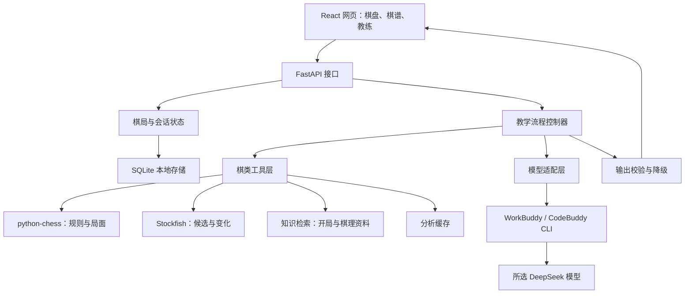

建议采用 **“保留旧项目底层能力，重构棋局状态、分析工具和讲解流程，新建网页界面”** 的路线。第一版只完成一个可靠的学习闭环：

**导入 PGN／FEN → 浏览棋局 → 讲解具体走法 → 自由追问 → 探索变例 → 回到原谱。**

下面作为实施方案 v1.0，供你审核。此时仍不修改项目。

**1. 产品目标与范围**

目标用户就是当前的你：国象联盟 965 分，主要下 10–15 分钟棋，实战依赖棋感，希望理解走法背后的原因，并逐步补上棋理基础。

第一版功能：

| 功能 | 实现范围 |
|---|---|
| PGN 导入 | 上传文件或粘贴文本；支持选择文件中的对局；保留原谱分支与注释 |
| FEN 导入 | 从单个局面开始探索；不推断未知历史 |
| 棋谱浏览 | 点击走法跳转、前后移动、翻转棋盘 |
| 棋盘探索 | 拖动走子、创建变例、切换分支、返回原谱 |
| 单步讲解 | 解释实际上一手，比较其他候选与对手应对 |
| 局面问答 | 回答威胁、计划、候选走法及棋理问题 |
| 假设推演 | 支持“如果走 X”“对方改走 Y”等追问 |
| 整局讲解 | 按需扫描并复核少量关键节点，归纳学习要点 |
| 可视化讲解 | 点击变化演示；显示经过校验的箭头和格子高亮 |
| 本地保存 | 保存导入棋局、探索分支、对话与分析结果，可继续上次学习 |

暂不做课程系统、战术题训练、错题复习、长期学习画像、账号系统、手机适配、截图识棋、模型微调。

本地保存只解决“关闭后还能接着看”，不扩展为个性化学习推荐。

**2. 页面与交互设计**

电脑端采用三块布局：

| 区域 | 内容 |
|---|---|
| 左侧：棋盘 | 棋子、箭头、高亮、行棋方、前后导航 |
| 中间：棋谱 | 原谱、变例树、当前节点、整局分析关键点 |
| 右侧：教练 | 对话、讲解卡片、可点击变化、分析进度 |

提供三个主要入口：

- **讲解这一步**：分析刚走完的实际走法。
- **分析当前局面**：分析下一步应该考虑什么。
- **讲解整盘棋**：扫描并总结关键节点。

这三个入口明确区分，避免“上一手”和“下一手”混淆。

交互规则：

- 拖动走子创建探索分支，不覆盖原谱。
- 原谱没有上一手时，禁用“讲解这一步”。
- 每条回答注明对应的棋谱节点；点击可回到该局面。
- 分析期间切换棋盘，返回结果仍归属于原请求节点。
- 默认直接解释；明确要求“给点提示”时控制揭示程度。
- 显示“正在比较候选”“正在检查反击”等进度，校验后的答案才进入正文。

**3. 总体架构**



技术选择：

- **前端**：React、TypeScript，可交互棋盘组件。
- **后端**：Python、FastAPI、Pydantic。
- **棋规与棋谱**：`python-chess`。
- **棋力分析**：Stockfish。
- **流程编排**：继续利用 LangGraph，但重写节点职责，取消重复的工具循环。
- **存储**：SQLite 保存结构化业务数据；原始 PGN 单独保留。
- **知识检索**：按需复用现有 Qdrant，不作为核心讲解启动的必要依赖。
- **模型入口**：优先验证 WorkBuddy CLI，适配层保留替换能力。

棋局状态、对话和工具执行全部由后端掌握，不依赖 CLI 的隐藏会话记忆。

**4. 内部状态设计**

需要明确区分三类状态：

| 状态 | 主要内容 | 更新方式 |
|---|---|---|
| 棋局状态 | 起始局面、原谱、变例、当前节点、行棋历史 | 棋规程序更新 |
| 对话状态 | 用户问题、回答、引用节点、当前讨论分支 | 应用维护 |
| 分析状态 | 候选、评分、变化、引擎版本、搜索条件 | 工具生成 |

核心对象包括：

- `Game`：导入来源、棋谱头、起始局面。
- `PositionNode`：父节点、走法、局面、是否原谱、注释。
- `AnalysisResult`：候选、评分视角、搜索条件、变化。
- `Evidence`：某个结论对应的可核验事实或资料。
- `Explanation`：结论、证据引用、变化引用、讲解内容。
- `RequestContext`：本轮问题绑定的棋局与节点。

模型通过节点 ID 引用局面，不自行生成用于替换真实棋盘的 FEN。

分析需保留必要历史，不能只看一个 FEN 就假装知道重复局面等信息。缓存也不能简单只用棋子位置作键，应包含影响结果的历史、规则状态和分析配置。

**5. 工具与调用流程**

保留 6 个对模型可见的棋类工具：

| 工具 | 职责 |
|---|---|
| `get_position` | 获取指定节点、历史和上一手前后局面 |
| `analyze_position` | 获取当前局面候选及分析线 |
| `compare_moves` | 从同一局面比较指定走法与引擎候选 |
| `explore_line` | 校验并执行变化，记录事件，分析所需节点 |
| `search_knowledge` | 查询棋理、开局和案例资料，返回来源 |
| `scan_game` | 初步扫描整局，筛选待复核节点 |

典型路由：

| 用户操作／问题 | 执行流程 |
|---|---|
| “讲解这一步” | 获取上一手 → 比较实际走法与候选 → 核查关键应对 → 讲解 |
| “现在应该怎么下” | 获取当前局面 → 多候选分析 → 必要时比较 → 讲解 |
| “为什么不能吃兵” | 明确走法 → 合法性检查 → 比较 → 检查反击 |
| “对方改走 X 呢” | 定位分支 → 执行变化 → 分析新局面 → 必要时比较对方候选 |
| “这是什么开局” | 获取历史 → 查询资料 → 检查名称与局面的匹配 |
| “整盘哪里出了问题” | 扫描 → 筛选 → 逐点复核 → 汇总 |

按钮入口执行固定流程；自由问题由模型生成结构化意图及工具请求。语义不明确才追问，不让模型每轮重新决定整个业务流程。

**6. 防幻觉与解释质量机制**

核心原则是：**先保证讨论对象与证据正确，再组织自然语言。**

具体实施：

1. **输入核验**  
   检查 PGN 解析错误、局面有效性、行棋方和走法合法性。部分解析失败时明确报告，不悄悄把截断棋谱当完整对局。

2. **固定比较基准**  
   评分统一视角；兵值与将杀距离分开表示。实际走法、候选走法在可比较的分析条件下评估。

3. **证据化生成**  
   工具返回事实、候选和变化编号。模型引用这些证据写讲解，棋盘展示引用同一批变化。

4. **区分变化与强制结果**  
   “这条线能赢子”不能自动写成“这步必然赢子”。检查对手替代应对，避免用配合变化证明走法正确。

5. **分层校验**  
   棋步、吃子、将军、将死、评分及引用由程序检查。战略解释与因果关系只能部分检查，需要保守表述和人工评估。

6. **有限修复**  
   默认最多进行两轮补充分析／修正，同时受总时间和调用预算限制。仍不确定时删去无依据结论，保留已确认内容。

7. **失败降级**  
   引擎失败时仍可浏览棋谱，但暂停具体优劣判断；知识库失败不阻断引擎分析；模型失败时可展示基础分析结果。

不承诺“零幻觉”。第一版重点确保：**不展示非法变化，不把错位局面当当前局面，不把未经核验的具体战术判断包装成确定事实。**

**7. WorkBuddy CLI 接入方案**

将 CLI 封装在独立适配器中，统一输入输出：

```text
输入：
问题 + 节点信息 + 必要对话 + 工具定义／工具结果

输出：
工具请求，或结构化讲解草稿
```

后端负责执行工具，将结果送回模型；模型不直接通过 Shell 操作棋局。

接入阶段必须验证：

- 当前安装版本与实际命令；
- 登录方式及可选模型 ID；
- 是否能稳定返回符合要求的结构化内容；
- 子进程退出、超时、取消和异常处理；
- 单轮与连续追问的耗时；
- 不同棋局的上下文隔离；
- 模型／渠道实际返回的版本信息，能获取时写入记录。

CLI 返回 JSON 只代表格式可解析，不代表讲解正确，仍要经过校验。

先采用简单、可控的调用方式，通过测试后再考虑常驻进程降低开销。运行目录与配置需要隔离，避免旧项目的提示文件或无关工具影响教练行为。

**尚待确认的只有接入方式：使用 WorkBuddy 登录后的内置额度，还是配置自己的 DeepSeek API Key。** 这不会改变主体架构，但必须在接入验证阶段明确。

**8. 旧代码复用与重构清单**

| 部分 | 处理方案 |
|---|---|
| PGN/FEN 解析 | 复用基础能力，升级为完整节点树，补充解析错误处理 |
| Stockfish 调用 | 整理为统一分析服务，增加资源管理、超时、缓存 |
| 局面特征 | 逐项审查含义，区分几何攻击、合法吃子与战术获利 |
| 假设走法工具 | 复用合法性处理，补充逐节点记录与候选比较 |
| 检索模块 | 延迟加载，保留来源，评估已有语料质量 |
| 模型客户端 | 增加 CLI 适配器，业务代码不绑定具体渠道 |
| 原 LangGraph | 重构路由和状态，移除内外重复工具循环 |
| Streamlit | 保留为旧版参考，新 Demo 使用独立前端 |
| 旧 SFT 数据与微调脚本 | 保留归档，不默认作为可靠教学材料 |

开发前检查版本控制状态，保留现有未提交改动，建立独立开发分支。旧版本继续可查，不直接覆盖为不可恢复的新版本。

**9. 实施阶段与交付物**

| 阶段 | 工作 | 交付及通过条件 |
|---|---|---|
| P0：可行性验证 | 检查旧项目运行条件，验证 CLI、模型与 Stockfish | 单个局面完成“分析 → 模型解释 → 结构化解析”；明确实际模型渠道 |
| P1：棋局基础 | 建立节点树、导入、浏览、变例和本地保存 | 原谱与分支正确，关闭重开可恢复 |
| P2：可靠讲解 | 实现分析、比较、变化工具与证据校验 | 单步讲解与假设追问闭环可用 |
| P3：完整交互 | 对话联动、点击演示、箭头高亮、请求取消 | 切换节点不串答案，讲解与棋盘一致 |
| P4：整局与知识 | 整局扫描、关键点复核、按需检索 | 可讲解一盘完整对局并追问关键点 |
| P5：评测与展示 | 回归集、人工评审、性能记录、演示材料 | 形成可复现 Demo 和真实评测报告 |

先完成 P0，再确定具体工期。CLI 稳定性、旧依赖兼容性和讲解质量会影响投入，不在未验证前承诺固定天数。

**10. 验收与算法侧评测**

建立约 40–60 个固定问题作为初始评测集，覆盖：

- 上一手与下一手的区分；
- 吃兵、交换、将军和反击；
- 非法走法及含糊指代；
- 黑白评分方向；
- 易位、升变、吃过路兵；
- 从 FEN 开始的非完整历史；
- 对手不按主变化走；
- 终局、引擎失败和知识未命中；
- 切换棋局与长对话后的上下文一致性。

验收分两层：

| 层次 | 标准 |
|---|---|
| 程序正确性 | 固定回归集上不出现非法展示变化、节点错配、评分视角错误、覆盖原谱等问题 |
| 教学质量 | 人工检查是否答对问题、理由有依据、表述适合你的水平、重要反驳是否遗漏 |

另外记录请求成功率、校验拦截率、重写次数、最终保留错误、响应耗时。不能把“拦截了很多错误”直接当作系统效果好，也不能把程序检查通过当作教学正确。

算法展示可以做三组对照，尽量使用相同模型与问题：

1. 当前旧流程；
2. 提供引擎事实但不做输出校验；
3. 新的证据与校验流程。

由此说明改善来自哪些机制，而不是只展示几个成功案例。微调意图识别模型作为后续实验，等实际请求积累和意图边界稳定后再做。

**11. 最终交付**

- 可本地运行的电脑端 Demo；
- 后端、前端和模型适配代码；
- 一键启动脚本与配置示例；
- 示例棋谱和演示流程；
- 架构、工具协议及维护说明；
- 固定评测集与实测结果；
- 已知限制及后续扩展清单。

建议你审核这版后，**首先实施 P0 和 P1；确认模型入口可用、棋局基础准确，再进入讲解流程开发。** 核心方案不依赖模型微调，也不把模型能力当作棋局正确性的唯一保障。